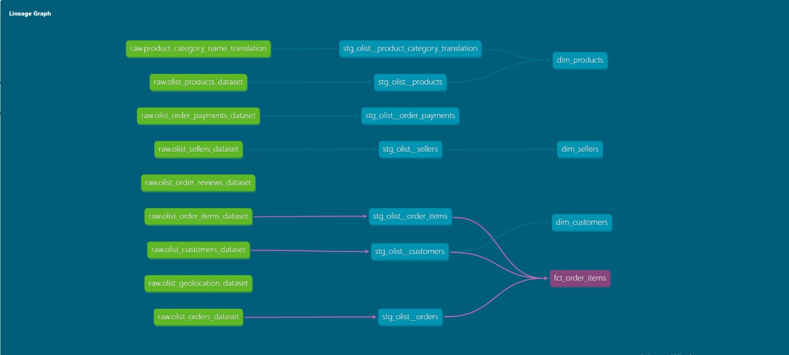

# Projeto 1 — Pipeline ELT com dbt + DuckDB + Star Schema

Pipeline ELT completo sobre o dataset [Olist E-commerce](https://www.kaggle.com/datasets/olistbr/brazilian-ecommerce), construído com **dbt Core** e **DuckDB**. O projeto cobre ingestão de dados brutos, camada de staging com testes de qualidade, modelagem dimensional (Star Schema) com integridade referencial e documentação automática.

## 🏗️ Arquitetura

raw (DuckDB) → staging (views) → marts (tables)
───────────────── ───────────────── ─────────────────
9 tabelas CSV 7 modelos de limpeza fct_order_items
ingeridas via Python + testes unique/not_null dim_customers

relationships dim_products
dim_sellers
dim_date




*(lineage completo disponível via `dbt docs serve`)*

## 🎯 Decisões de modelagem

### Grão da tabela fato
`fct_order_items` tem grão de **item de pedido** — uma linha por item dentro de um pedido. A chave composta é `(order_id, order_item_id)`, materializada como surrogate key `order_item_sk` para permitir teste `unique`.

### Dimensão cliente no grão da pessoa
`dim_customers` usa `customer_unique_id` como chave, **não** `customer_id`. No Olist, `customer_id` é único **por pedido**, não por pessoa — usar `customer_id` duplicaria a dimensão. A consolidação é feita com `GROUP BY customer_unique_id`.

### Pagamentos fora da fato de itens
`fct_order_items` **não** inclui `payment_value`. Pagamentos têm grão diferente (um pedido pode ter múltiplos pagamentos), e juntá-los na fato de itens causaria **fan-out** — duplicação de `price` e `freight_value`. Pagamentos merecem uma `fct_order_payments` separada (trabalho futuro).

### Dimensão data gerada
`dim_date` é gerada com `generate_series` de 2016-01-01 a 2019-12-31, garantindo **continuidade temporal**. Se fosse derivada apenas das datas dos pedidos, dias sem venda sumiriam dos relatórios.

### Materialização
- **Staging como `view`** — leve, sempre reflete a fonte, sem armazenamento extra
- **Marts como `table`** — BI consulta muito, precisa ser rápido

## 🧪 Testes de qualidade

O projeto tem **40+ testes declarativos** no dbt:

- `unique` e `not_null` nas chaves primárias de staging e dimensões
- `accepted_values` em domínios (status de pedido, tipo de pagamento)
- `relationships` de `fct_order_items` para as 4 dimensões (integridade referencial)

Para rodar todos:

```bash
dbt build

Pré-requisitos
Python 3.10+

dbt-core, dbt-duckdb

# 1. Clonar o repositório
git clone https://github.com/DiegoTaborda/projeto1.git
cd projeto1

# 2. Criar e ativar ambiente virtual
python -m venv .venv
source .venv/bin/activate   # Linux/Mac
# ou .\.venv\Scripts\Activate.ps1   # Windows

# 3. Instalar dependências
pip install dbt-core dbt-duckdb

# 4. Baixar os CSVs do Olist
# Coloque os 9 arquivos em `data_raw/`
# Disponível em: https://www.kaggle.com/datasets/olistbr/brazilian-ecommerce

# 5. Carregar dados no DuckDB
python load_olist.py

# 6. Rodar o pipeline completo
dbt build

# 7. Visualizar documentação
dbt docs generate
dbt docs serve

projeto1/
├── data_raw/              # CSVs brutos (gitignored)
├── load_olist.py          # Script de ingestão CSV → DuckDB
├── models/
│   ├── staging/olist/     # 7 modelos de limpeza + testes
│   └── marts/core/        # Star Schema (fato + 4 dimensões)
├── profiles.yml           # Conexão DuckDB
├── dbt_project.yml        # Configuração do projeto
└── README.md